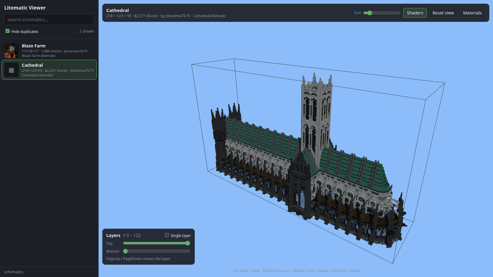
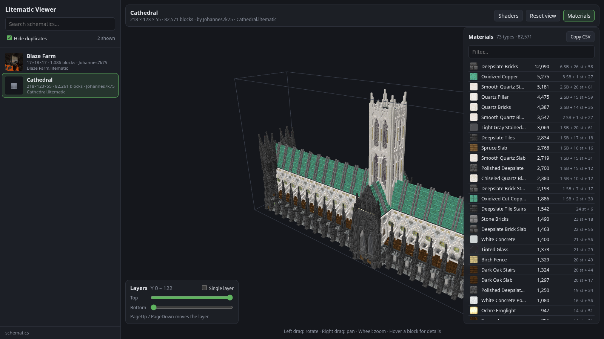
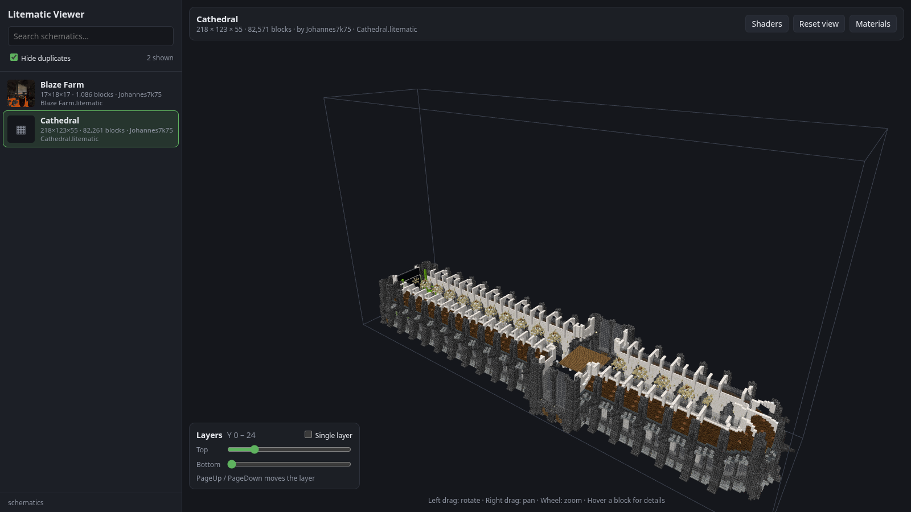
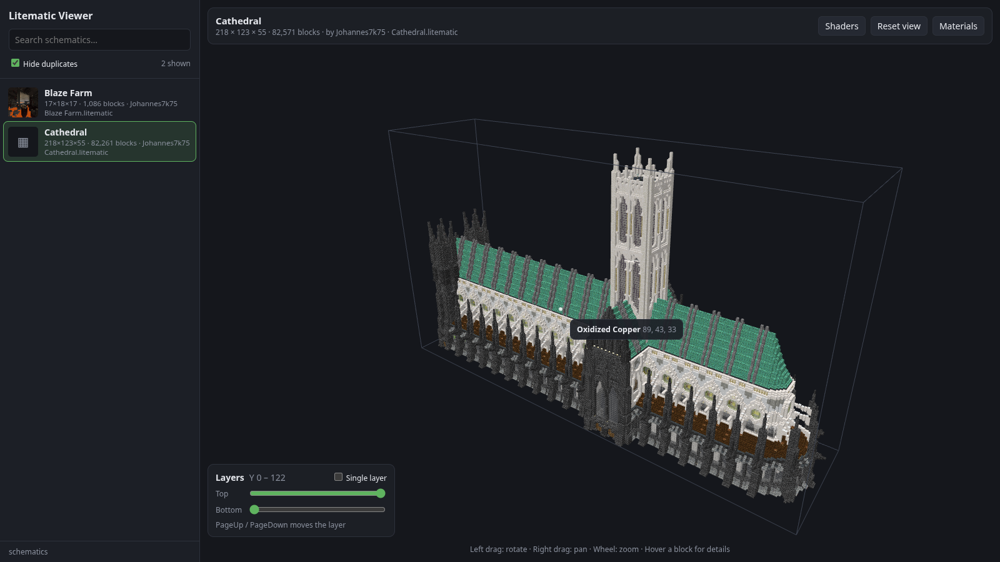

# Litematic Viewer

A local 3D viewer for [Litematica](https://github.com/maruohon/litematica) `.litematic`
schematics, rendered with Minecraft's real block textures and models.

Point it at a folder, open your browser, and browse every schematic you have, with no
Minecraft install needed.

Built with [Bun](https://bun.sh), [Hono](https://hono.dev), [ConnectRPC](https://connectrpc.com),
[SolidJS](https://www.solidjs.com) and [three.js](https://threejs.org).



## Features

- **Schematic browser**: every `.litematic` in a folder (searched recursively), with Litematica
  preview thumbnails, search and duplicate hiding
- **Textured 3D render** using vanilla block models: stairs, slabs, redstone, rails, glass,
  water and lava, chests (single, double, trapped, ender, copper) and more
- **Shaders**: optional sunlight, shadows and ambient occlusion, with an adjustable sun angle
- **Layer slicing**: show a range of layers or a single one (`PageUp` / `PageDown`)
- **Block inspector**: hover a block to see its name, block state and coordinates
- **Material list** with stack and shulker box counts, and CSV copy
- **Mob spawner previews**: a small textured model of the spawner's mob
- **Drag and drop** a `.litematic` onto the view to open it without copying it into the folder

| Key | Action             |
| --- | ------------------ |
| `R` | Reset camera       |
| `M` | Toggle materials   |
| `L` | Toggle shaders     |
| `PageUp` / `PageDown` | Move the layer slice |

| Material list | Layer slicing | Block inspector |
| :---: | :---: | :---: |
|  |  |  |

## Quick start with Docker

You only need Docker with Compose.

```sh
git clone https://github.com/Johannes7k75/litematic-viewer.git
cd litematic-viewer
docker compose up -d
```

Open <http://127.0.0.1:8765/>. The block textures and the client are built into the image,
so there is nothing else to set up.

By default this serves `./schematics`. Change it with environment variables or a `.env` file
next to `docker-compose.yml`:

```sh
# .env
SCHEMATICS_DIR=/path/to/your/schematics
PORT=8765
```

| Variable         | Default        | Description                                        |
| ---------------- | -------------- | -------------------------------------------------- |
| `SCHEMATICS_DIR` | `./schematics` | Folder with `.litematic` files (mounted read-only) |
| `PORT`           | `8765`         | Host port; only published on `127.0.0.1`           |

After updating the code, run `docker compose up -d --build`.

## Running from source

Install [Bun](https://bun.sh) 1.4 or newer, then:

```sh
bun install
bun start                    # serve ./schematics
bun start /some/folder       # or any folder (searched recursively)
```

This opens <http://127.0.0.1:8765/> in your browser. The server only listens on localhost.
On first start the block assets are built (see [Block assets](#block-assets)); the client is
rebuilt on every start.

| Option          | Default     | Description                                      |
| --------------- | ----------- | ------------------------------------------------ |
| `--port`        | `8765`      | HTTP port                                        |
| `--host`        | `127.0.0.1` | Address to listen on                             |
| `--no-browser`  |             | Don't open a browser tab                         |
| `--dev`         |             | Rebuild the client on changes (see Development)  |
| `--prebuilt`    |             | Serve `dist/` and `assets/` without rebuilding   |

### Gathering your schematics

Schematics usually end up spread across many launcher instances. `collect` copies every
`.litematic` it finds into `./schematics/<instance>/…`, skipping identical copies and the
Windows recycle bin:

```sh
bun run collect ~/.local/share/PrismLauncher/instances /mnt/windows/Users/you
```

## How it works

The server parses schematics with prismarine-nbt and sends the block grid to the browser over
RPC, where it is meshed in a Web Worker and drawn with three.js.

### Block assets

The asset builder bakes blockstates, block models and textures into `assets/atlas.png` and
`assets/blocks.json`. They come from PrismarineJS
[minecraft-assets](https://github.com/PrismarineJS/minecraft-assets) (the newest version it
has); block names, collision shapes and tints come from
[minecraft-data](https://github.com/PrismarineJS/minecraft-data). Both are npm packages, so
nothing is downloaded from Mojang.

```sh
bun run build:assets                         # newest minecraft-assets version
bun run build:assets 1.21.11                 # a specific version
bun run build:assets path/to/client.jar      # a Minecraft client jar, e.g. for a newer release
```

### API

The browser talks to the server through `litematic.v1.ViewerService`, defined in
[`proto/litematic/v1/viewer.proto`](proto/litematic/v1/viewer.proto) and served with ConnectRPC
under `/rpc` (binary protobuf, gzip for large replies).

| RPC              | Description                                        |
| ---------------- | -------------------------------------------------- |
| `ListSchematics` | All schematics in the served folder, with metadata |
| `GetSchematic`   | Parse one of them into a block grid                |
| `ParseSchematic` | Parse an uploaded file (drag and drop)             |

It is plain HTTP, so you can call it with curl too (JSON instead of protobuf):

```sh
curl -H 'Content-Type: application/json' -d '{"path":"farms/Blaze Farm.litematic"}' \
  http://127.0.0.1:8765/rpc/litematic.v1.ViewerService/GetSchematic
```

Thumbnails are a plain URL (`/api/preview?p=<path>`) so they work as ``.

### Limitations

- Blocks that Minecraft draws with entity renderers and that have no block model (heads, shulker
  boxes, decorated pots, banners) are drawn as textured boxes in the shape of their collision
  box. Chests are rebuilt from the chest entity model.
- Spawner previews cover zombies, husks, drowned, skeletons, strays, wither skeletons, bogged,
  spiders, cave spiders, blazes, silverfish, magma cubes, slimes, pigs and creepers. Other mobs
  and empty spawners show the cage only.

## Development

```sh
make                              # list all targets
make dev                          # rebuild the client and restart the server on changes
make check                        # buf lint, type-check and tests (run before committing)
make start DIR=~/schematics       # build and serve a folder
make generate                     # lint proto/ and regenerate src/gen/ (Docker)
make proto-check                  # fail if src/gen/ is stale (Docker)
make assets JAR=1.21.11           # rebuild assets/ (a version or a client jar path)
```

Make variables: `DIR` (schematics folder), `PORT` (default 8765), `ARGS` (extra server flags,
for example `ARGS=--no-browser`) and `JAR` (version or jar for `make assets`). In `make dev`,
reload the page after a client rebuild.

Equivalent `bun run` scripts exist for most targets: `start`, `dev`, `build`, `build:assets`,
`generate`, `collect`, `typecheck`, `test` and `lint:proto`.

### Screenshots

The README screenshots in `docs/screenshots/` are taken by `bun run screenshots`. It starts a
viewer on a temporary folder holding only the chosen schematics and captures it with headless
Chromium through [puppeteer-core](https://pptr.dev):

```sh
bun run screenshots              # all shots
bun run screenshots hover        # only some of them (viewer, materials, layers, hover)
```

Configure it with `SCHEMATICS` (comma-separated `.litematic` files, relative to `./schematics`
or absolute; the first one is opened), `PORT` (default 8799) and `CHROME_BIN` (default
`/usr/bin/chromium`).

After editing the `.proto`, run `make generate`. It runs [buf](https://buf.build) and
[protoc-gen-es](https://github.com/bufbuild/protobuf-es) in Docker with versions pinned in the
`Makefile`, so nothing extra needs installing. The generated files are committed, and
`bun test` runs `make proto-check` when Docker is available.

## Disclaimer

Not an official Minecraft product. Not approved by or associated with Mojang or Microsoft.
Minecraft textures and models are loaded from the minecraft-assets package at build time and
are not part of this repository.
